# ZMK CONFIG FOR THE CHARYBDIS 4X6 WIRELESS SPLIT KEYBOARD

## BOM

Here is the BOM for this project: [BOM Charybdis 4x6 Wireless](/docs/bom/readme.md)

## Keymap

Auto-generated by [keymap-drawer](https://github.com/caksoylar/keymap-drawer) on every keymap change.

